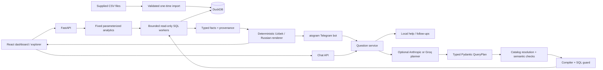

# UZEX Data Assistant

A bilingual analytics prototype for exploring a **synthetic** commodity-exchange dataset. It combines a deterministic DuckDB analytics layer with an optional LLM that translates Uzbek or Russian questions into typed query plans. The web dashboard, deal explorer, exports, local help, and evidence views do not require an LLM.

This was built for a UZEX hackathon. It is **not an official UZEX product**. The supplied dataset covers **3 January 2022–30 October 2026**; deal statuses are a snapshot as of **30 October 2026**. No current-market prices or future outcomes are implied.

## Why this project exists

Exchange records contain dates, amounts, currencies, product variants, lot multipliers, parties, brokers, delivery state, and several distinct region roles. A useful answer must preserve those distinctions: contract value is not profit; a USD contract needs its supplied deal-date FX rate; litres and tonnes cannot be added; and “Tashkent” may mean the city or the region. The project makes these constraints explicit in both the SQL layer and the response.

## Architecture



The LLM plans a query; it does not supply answer values. The application resolves names against catalogs, validates the plan, binds parameter values, executes approved SQL, and renders computed facts with their scope and sources. There is a guarded `custom_sql` path for questions outside the fixed metric catalog; it is restricted to one read-only statement and the same worker limits. This is defense in depth, not a claim that AST parsing alone is a security boundary.

## What is implemented

| Area | Implementation |
| --- | --- |
| Data engineering | Strict CSV header/row checks, typed import, source-file fingerprints, unique-key and join-fan-out checks, prepared DuckDB database |
| Calculations | Exact decimal contract amounts, deal-date USD→UZS conversion from the supplied rate table, lot-count × lot-size quantities, compatible-unit grouping, named status policies |
| Question answering | Uzbek Latin/Cyrillic and Russian language handling, typed plans, local entity resolution, focused ambiguity prompts, bounded SQL execution, deterministic grounded rendering |
| Web | FastAPI plus React/TypeScript/Vite/Recharts; dashboard aggregates, validated URL filters, paginated deal explorer, bounded CSV export, chat and evidence |
| Telegram | aiogram commands, free-text questions, scoped clarification sessions, source buttons, message splitting, local help and explanations |
| Reliability | 70-second question budget including queue/rate waits, read-only worker processes with termination on timeout, result-size limits, shared SQLite rate gate for processes using one credential |

The browser and Telegram use the same question service. Dashboard and explorer queries are written by the application, not by the LLM. `tests/fixture/` contains small, manually checkable synthetic examples; `scripts/eval/reference*.py` computes independent answers from the supplied raw CSVs when those files are available.

## Stack

- Python 3.12, FastAPI, Pydantic, DuckDB 2.0, SQLGlot, aiogram 3.
- React 19, TypeScript 5, Vite 8, Recharts 3.
- Official Anthropic and Groq SDK adapters. Provider selection is explicit; there is no automatic switch between providers. The Anthropic adapter can request an optional server-side model fallback when `UZEX_LLM_FALLBACKS=true`, and evidence records the model actually served. The observed local release on 14 November 2026 used Anthropic `claude-opus-5-5` with prompt `p4-2026-11-05.2-tables`; earlier evaluation documents also describe Groq builds. Those historical results are not measurements of the current planner.
- Versions are pinned in `requirements.lock` and `web/package-lock.json`. `requirements-runtime.lock` is the smaller container runtime set.

## Trust and answer provenance

The query plan records intent, entities and roles, period, metrics, filters, grouping, ordering, units/currency, status policy, comparisons, and ambiguity. A resolver normalizes spelling and script while retaining original names, STIR/ИНН, and codes. Similar names are candidates, not proof of identity.

The compiler uses allowlisted dimensions and bound values. The SQL guard parses exactly one statement, traverses nested queries/CTEs/set operations, and rejects writes, DDL, system catalogs, external reads, dynamic table/file functions, and disallowed columns/functions. Execution opens DuckDB read-only, disables external access/extensions, and runs in bounded workers that can be terminated. See [query engine](docs/query_engine.md) for details and limitations.

Answers distinguish verified zero, no matching rows, unavailable fields, out-of-period questions, ambiguity, refusal, and execution failure. Evidence records query ID, SQL/parameters internally, source files, source-row count, period, filters, policy, units, conversions, and sample IDs. The renderer generates numbers and names from typed results; it does not ask a second LLM to write prose. See [data model](docs/data_model.md) and [answer rendering](docs/answer_rendering.md).

## Run locally

### 1. Offline, without the supplied dataset or any API key

```bash
python3.12 -m venv .venv
.venv/bin/python -m pip install -r requirements.lock
.venv/bin/python -m pip install -e . --no-deps
cp .env.example .env  # template defaults to UZEX_LLM_PROVIDER=none
.venv/bin/python -m pytest tests/fixture -q
```

The fixture suite builds tiny temporary databases and makes no paid LLM calls. For a small local web demonstration using the fixture data:

```bash
mkdir -p .local
.venv/bin/python -c "from pathlib import Path; from tests.fixture.engine_fixture import build; build(Path('.local/fixture'))"
cd web && npm ci && npm run build && cd ..
UZEX_DATA_DIR=.local/fixture/raw UZEX_DB_PATH=.local/fixture/db/engine.duckdb \
  UZEX_LLM_PROVIDER=none .venv/bin/python -m uzex_assistant.web
```

Open `http://127.0.0.1:8000`. This tiny fixture is for engineering checks, **not** the 500,000-deal demonstration. Stop any other process already using port 8000. The frontend build is served by FastAPI from the same origin.

### 2. Full dataset, if you have permission to use it

Place the original CSV set described in [data model](docs/data_model.md) under `uzex_spot_data/`, and provide a matching prepared DuckDB database under `data/`. These files are **not distributed in this repository**. A one-time import is separate from read-only web/bot runtime; this historic release also has a submission freeze check. A new post-freeze import requires an explicitly authorized development or release procedure rather than silently rebuilding the data. Check `python -m uzex_assistant.importer status` and `/api/health` before starting services.

For natural-language chat, set `UZEX_LLM_PROVIDER`, `UZEX_LLM_MODEL`, and `UZEX_LLM_API_KEY` in the untracked `.env`. The bot additionally needs `UZEX_BOT_TOKEN`. Never put these values in frontend code, shell history, screenshots, or a repository. Run one bot polling process per token. Dashboard, explorer, and fixture tests work without a provider.

## Verification and reproducibility

```bash
.venv/bin/python -m pytest -q               # live module is skipped unless explicitly enabled
.venv/bin/python -m pip check
cd web && npm run typecheck && npm run build
```

On 14 November 2026, the local suite produced **507 passed, 1 skipped**; `npm run typecheck` and `pip check` passed. The skipped live module is **not** a verified live result. Independent raw-CSV reference scripts, fixed-plan tests, web/bot integration tests, and real-provider rounds are reported separately in [evaluation](docs/evaluation.md) and [accuracy audit](docs/accuracy_audit.md). Their measurements belong to the documented builds and environments; they should not be presented as a current accuracy percentage. This project is a retrieval/query-and-calculation system, not a trained predictive ML model.

## Screenshots and demo

The live prototype, when the host and tunnel are running, is [uzex.muminova.uz](https://uzex.muminova.uz). Availability is not guaranteed: the demo is currently hosted on a laptop through an SSH tunnel.

The following are genuine browser captures of the current frontend running against the small synthetic test fixture in `tests/fixture/engine_fixture.py`. The displayed 15 deals and amounts are fixture values, **not** results from the supplied 500,000-deal dataset. The AI screenshot intentionally shows an unconfigured provider; it does not imply a successful live LLM response.

| Dashboard | Deal explorer | AI assistant |
| --- | --- | --- |
| [View screenshot](docs/portfolio/dashboard.png) | [View screenshot](docs/portfolio/explorer.png) | [View screenshot](docs/portfolio/assistant.png) |

These screenshots were captured at 1440 CSS pixels on 14 November 2026 from a localhost fixture server. Older screenshots of the supplied dataset remain excluded pending publication rights.

## Limitations and engineering choices

- The supplied synthetic CSVs and prepared database are omitted pending redistribution rights. A clean public checkout supports fixture tests, but cannot reproduce full-dataset answers without authorized data.
- LLM planning is probabilistic. Validation and clarification reduce errors but do not prove every question is understood. Historical live rounds include incorrect plans; see the evaluation documents rather than treating offline fixed-plan scores as language accuracy.
- The snapshot ends on 30 October 2026. Forecasts, profits, costs, bank details, live prices, and later contract outcomes are unavailable.
- Unit prices and comparisons require a compatible product variant, measurement unit, currency, and period. A missing or zero denominator is not turned into an invented percentage.
- A 70-second budget bounds individual questions but provider quotas and the laptop/tunnel deployment can still make chat unavailable. Local analytics and help continue to work.
- The SQL guard is one layer of a restricted, read-only design. It is not a general-purpose sandbox for arbitrary SQL.
- No Git history is present in this working directory. Commit provenance and historical secret exposure cannot be established from this copy.

Future work: package a separately licensed sample dataset and reproducible demo database, run larger blinded bilingual live evaluations, improve deployment availability, add automated dependency/security scanning, and publish a versioned release with a traceable commit.

## Repository hygiene

The `.gitignore` excludes credentials, raw data, DuckDB files, question logs, generated evaluation output, local release copies, and host-specific deployment files. Review the staged file list and secret scan **before** the first commit; no GitHub repository or push is created by these instructions. The real `.env` should remain mode `0600` on the host. Do not publish raw question journals: they can contain IPs, user handles, and private questions.

## License and data rights

No code license has been selected for this repository. The supplied synthetic dataset has no redistribution grant in the materials reviewed for this portfolio, so its CSVs, database, and screenshots of data-derived results remain out of the prepared Git tree. Confirm publication rights for derived examples and evaluation figures before making the repository public.
